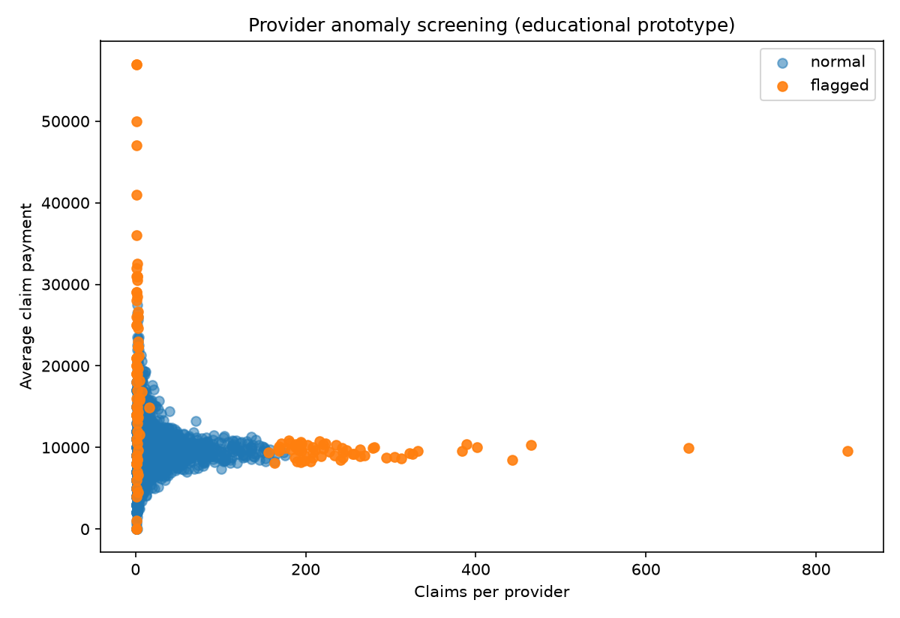

# CMS Claims Anomaly Screening + MLOps

**Portfolio project for Data Scientist / ML Engineer interviews involving CMS claims, ETL/ELT, SQL, model evaluation, MLflow, Docker, CI/CD, and cloud/lakehouse concepts.**

> **Important:** This repository is an educational anomaly-screening prototype. CMS DE-SynPUF is synthetic and does not contain an adjudicated fraud label. A flagged provider is **not** evidence of fraud.



## What this project demonstrates

- Python: Pandas, NumPy, scikit-learn, Matplotlib
- SQL: claim-to-provider aggregation using SQLite
- Structured claims data ETL and data-quality checks
- Feature engineering at claim and provider levels
- Unsupervised learning: Isolation Forest provider anomaly screening
- Supervised learning: high-cost claim classification
- Evaluation: precision, recall, F1, ROC-AUC, PR-AUC
- Reproducibility: config file, deterministic seeds, tests, pinned dependency ranges
- MLflow: experiment tracking + SQLite-backed model registry
- Docker containerization
- GitHub Actions CI
- Production mapping to AWS / Databricks / Feature Store / Unity Catalog

## Data source

The intended real dataset is the **CMS 2008-2010 Data Entrepreneurs' Synthetic Public Use File (DE-SynPUF)**. CMS created it so developers and researchers can learn claims structure and build programs while protecting beneficiary privacy.

Official landing page:
https://www.cms.gov/data-research/statistics-trends-and-reports/medicare-claims-synthetic-public-use-files

The repository includes a **CMS-shaped demo data generator** only so CI and reviewers can run the project quickly without downloading a large public file. For the portfolio demo, use the official CMS file when possible.

## Architecture

```text
CMS DE-SynPUF inpatient claims
        |
        v
Pandas ingest -> schema/data-quality validation -> cleaning
        |
        v
SQLite claims table
        |
        v
SQL provider feature aggregation
        |
        +----------------------+
        |                      |
        v                      v
Isolation Forest          Claim-level Random Forest
provider ranking          high-cost classification
        |                      |
        +----------+-----------+
                   v
          MLflow Tracking/Registry
                   |
             Docker + CI
```

See [`docs/ARCHITECTURE.md`](docs/ARCHITECTURE.md) for the production mapping.

## Quick start A - fast demo

```bash
python -m venv .venv
# Windows: .venv\Scripts\activate
# macOS/Linux: source .venv/bin/activate
pip install -r requirements-dev.txt
pip install -e .

python scripts/generate_demo_data.py --rows 12000
python scripts/run_pipeline.py
python scripts/show_top_risk.py --n 10
```

Generated artifacts:

```text
artifacts/
  run_summary.json
  provider_risk_scores.csv
  top_provider_anomalies.csv
  provider_risk_scatter.png
  provider_anomaly_model.joblib
  high_cost_claim_classifier.joblib
  high_cost_confusion_matrix.png
  high_cost_feature_importance.csv
  mlflow/mlflow.db
```

## Quick start B - official CMS DE-SynPUF data

```bash
python scripts/download_cms_data.py
python scripts/run_pipeline.py
```

If the CMS download URL changes, download an inpatient DE-SynPUF sample manually from the official CMS page and place the CSV at:

```text
data/raw/inpatient_claims.csv
```

Then run:

```bash
python scripts/run_pipeline.py
```

## View MLflow

After at least one MLflow-enabled run:

```bash
mlflow ui --backend-store-uri sqlite:///artifacts/mlflow/mlflow.db --port 5000
```

Open `http://127.0.0.1:5000`.

What to show in an interview:
1. experiment run parameters
2. model metrics
3. plots/artifacts
4. registered model versions
5. input example / model metadata

## ETL / ELT talking point

This repository implements a local **ETL** flow: read the source claim file, validate/transform it, then load the cleaned data into SQLite for SQL analytics. A cloud/lakehouse variant could be **ELT**: land raw files in S3/Delta first, then transform in Databricks SQL/Spark.

## Feature engineering

Claim-level derived features include:
- length of stay
- weekend claim start
- diagnosis count
- procedure count
- primary payer zero indicator
- high-cost indicator

Provider-level SQL features include:
- claim count and unique beneficiaries
- total/average/max payment
- utilization and length-of-stay statistics
- high-cost claim share
- weekend start share
- diagnosis/procedure intensity
- claims per beneficiary
- active months

## Why two models?

### 1. Provider anomaly screening - primary FWA-inspired use case

`IsolationForest` ranks providers whose behavior is unusual relative to peers. This is appropriate for a portfolio prototype because the public synthetic file does not supply a trustworthy fraud label.

The output includes simple reason codes (largest robust deviations) so the ranking is easier to discuss with an analyst.

### 2. High-cost claim classifier - supervised learning demonstration

A separate Random Forest predicts a derived `is_high_cost_claim` target. This task exists to demonstrate supervised training, class imbalance, and evaluation. It is not presented as fraud prediction.

## Reproducibility

- all tunable values live in `config/config.yaml`
- `random_state: 42`
- raw and processed data are excluded from Git
- deterministic demo generator for CI
- tests cover transformation, SQL aggregation, and model training
- MLflow records run parameters, metrics, model artifacts, and versions

## CI/CD concepts

`.github/workflows/ci.yml` runs on push / pull request:

```text
checkout -> install -> lint -> unit tests -> end-to-end smoke test
```

A production CD extension could add:

```text
successful CI -> model validation -> registry tag/approval -> deployment -> monitoring
```

## Docker

```bash
docker build -t cms-claims-ml .
docker run --rm cms-claims-ml
```

For real data, mount the data directory instead of baking claims into the image:

```bash
docker run --rm \
  -v "$PWD/data:/app/data" \
  -v "$PWD/artifacts:/app/artifacts" \
  cms-claims-ml
```

## AWS / Databricks production mapping

| Portfolio component | Production-oriented equivalent |
|---|---|
| local raw CSV | S3 / Delta Lake |
| Pandas transforms | Spark / Databricks jobs |
| SQLite SQL | Databricks SQL / Delta tables |
| provider feature CSV | Feature Store |
| local MLflow SQLite | managed MLflow + Unity Catalog registry |
| batch script | workflow/scheduled job or REST serving |
| Docker | ECR + EKS/SageMaker, depending on platform |
| GitHub Actions | enterprise CI/CD with approval gates |

## Repository structure

```text
.
├── config/config.yaml
├── data/
├── docs/
├── scripts/
├── sql/provider_features.sql
├── src/cms_claims/
├── tests/
├── .github/workflows/ci.yml
├── Dockerfile
├── Makefile
└── README.md
```

## mlflow access
mlflow ui \
  --backend-store-uri sqlite:///artifacts/mlflow/mlflow.db \
  --host 0.0.0.0 \
  --port 5000


## Interview walkthrough

Use [`docs/INTERVIEW_GUIDE.md`](docs/INTERVIEW_GUIDE.md). The recommended demonstration is 5-7 minutes: problem framing -> ETL/SQL -> modeling -> MLflow -> Docker/CI -> AWS/Databricks extension.

## Limitations and next steps

- Synthetic data should not support real-world prevalence or causal claims.
- Isolation Forest flags statistical unusualness, not fraud.
- A production FWA system would require adjudicated outcomes, temporal validation, leakage controls, investigation feedback loops, fairness/governance review, and monitoring.
- A Databricks version would move feature definitions into governed Delta/Feature Store assets and register models in Unity Catalog.
